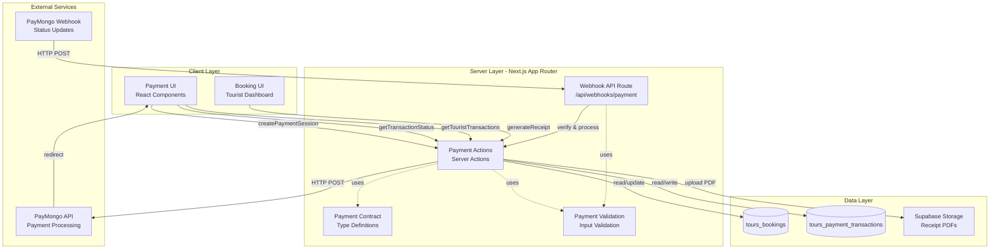

# Design Document: Payment System

## Overview

The Payment System enables tourists to complete tour bookings through secure payment processing with Philippine payment gateways. The system architecture consists of four primary components: Payment UI (client-side interfaces), Payment Processor (server-side orchestration), Gateway Integration (external payment service communication), and Webhook Handler (asynchronous status synchronization).

**Design Philosophy:**
- **Security-first:** All sensitive payment data is handled exclusively by the payment gateway; our system stores only tokens and transaction metadata
- **Idempotent operations:** Payment creation and webhook processing are designed to be safely retryable
- **Eventual consistency:** Booking status updates are asynchronous, with retry mechanisms for reliability
- **Mobile-optimized:** Payment flows are designed for mobile-first usage patterns with responsive layouts

**Primary Use Cases:**
1. Tourist initiates payment for pending booking → redirected to gateway → completes payment → returns to confirmation
2. Payment gateway sends webhook notification → system updates transaction and booking status
3. Tourist views transaction history and downloads receipts for completed payments

## Architecture

### Component Diagram



### Data Flow: Payment Lifecycle

**Phase 1: Initiation**
1. Tourist clicks "Proceed to Payment" on pending booking
2. Client calls `createPaymentSession(bookingId)` Server Action
3. Server validates booking ownership, status, and amount
4. Server generates idempotency key: `payment_${bookingId}_${timestamp}`
5. Server calls PayMongo API to create payment intent with success/cancel URLs
6. Server stores transaction record with status "pending" and payment token
7. Client redirects tourist to PayMongo checkout URL

**Phase 2: Processing**
8. Tourist selects payment method and submits payment on PayMongo checkout
9. PayMongo processes payment and sends webhook to `/api/webhooks/payment`
10. Webhook handler verifies signature, extracts payment token, updates transaction to "processing"
11. PayMongo redirects tourist to success URL with transaction reference

**Phase 3: Completion**
12. Webhook handler receives final status from PayMongo (success or failure)
13. Handler updates transaction status to "completed" or "failed"
14. Handler triggers booking status update from "pending_payment" to "completed"
15. Tourist arrives at success page, sees updated booking status
16. Tourist can download receipt for completed payment

### Integration with Existing Booking System

The Payment System integrates with the existing `tours_bookings` table through these touch points:

1. **Read-only access for payment initiation:**
   - Reads `booking_id`, `tourist_id`, `total_amount` to create payment session
   - Validates booking status is "pending_payment" before allowing payment

2. **Write access for status updates:**
   - Updates `status` from "pending_payment" to "completed" on successful payment
   - Updates `updated_at` timestamp on status change

3. **Authorization alignment:**
   - Uses same `getAuthenticatedSession` pattern from booking module
   - Respects tourist ownership through `tourist_id` filtering
   - Follows existing RLS policies on bookings table

**No breaking changes to booking module:** The payment system extends bookings without modifying existing booking creation or management flows.

## Components and Interfaces

### 1. Payment Contract (`src/lib/tours/payment-contract.ts`)

Centralized type definitions and field mappings following project pattern from `booking-contract.ts` and `package-contract.ts`.

```typescript
import "server-only";

/**
 * Payment Engine Contract
 * 
 * Centralized data mapping between JavaScript (camelCase) and database (snake_case).
 * Database table: tours_payment_transactions
 * 
 * Use this file as the source of truth for field names. If the schema changes, update here first.
 */

export const PAYMENT_TRANSACTIONS_TABLE = "tours_payment_transactions";

/**
 * Field mapping: JavaScript → Database column names
 */
export const PAYMENT_FIELDS = {
  id: "id",
  bookingId: "booking_id",
  paymentToken: "payment_token",
  paymentMethod: "payment_method",
  amount: "amount",
  currency: "currency",
  status: "status",
  gatewayResponse: "gateway_response",
  idempotencyKey: "idempotency_key",
  refundedAmount: "refunded_amount",
  refundReason: "refund_reason",
  refundedAt: "refunded_at",
  createdAt: "created_at",
  updatedAt: "updated_at",
} as const;

/**
 * Payment status enum
 * 
 * State transitions:
 * pending → processing → completed
 * pending → processing → failed
 * pending → expired (timeout)
 * completed → refunded (future)
 */
export type PaymentStatus = 
  | "pending" 
  | "processing" 
  | "completed" 
  | "failed" 
  | "expired" 
  | "refunded";

/**
 * Payment method enum
 * Supported by PayMongo in Philippines
 */
export type PaymentMethod = 
  | "gcash" 
  | "card" 
  | "bank_transfer" 
  | "paymaya" 
  | "grabpay";

/**
 * Core transaction record
 */
export interface TransactionRecord {
  id: string;
  booking_id: string;
  payment_token: string | null;
  payment_method: PaymentMethod | null;
  amount: number;
  currency: string;
  status: PaymentStatus;
  gateway_response: Record<string, any> | null;
  idempotency_key: string;
  refunded_amount: number;
  refund_reason: string | null;
  refunded_at: string | null;
  created_at: string;
  updated_at: string;
}

/**
 * Transaction with booking details (for display)
 */
export interface TransactionWithBooking extends TransactionRecord {
  bookings?: {
    id: string;
    package_id: string;
    booking_date: string;
    packages?: {
      title: string;
      location_name: string;
      operator_id: string;
      profiles?: {
        full_name: string | null;
      };
    };
  };
}

/**
 * Transaction list query
 */
export const TRANSACTION_LIST_SELECT = `
  id,
  booking_id,
  payment_method,
  amount,
  currency,
  status,
  created_at,
  bookings(
    id,
    package_id,
    booking_date,
    packages(
      title,
      location_name,
      operator_id,
      profiles(full_name)
    )
  )
`;

/**
 * Transaction detail query
 */
export const TRANSACTION_DETAIL_SELECT = `
  id,
  booking_id,
  payment_token,
  payment_method,
  amount,
  currency,
  status,
  gateway_response,
  idempotency_key,
  refunded_amount,
  refund_reason,
  refunded_at,
  created_at,
  updated_at,
  bookings(
    id,
    package_id,
    booking_date,
    total_amount,
    tourist_id,
    packages(
      title,
      description,
      location_name,
      operator_id,
      profiles(full_name)
    )
  )
`;

/**
 * PayMongo payment intent request
 */
export interface PayMongoPaymentIntentRequest {
  data: {
    attributes: {
      amount: number; // in centavos
      currency: string; // "PHP"
      description: string;
      statement_descriptor?: string;
      metadata?: Record<string, string>;
    };
  };
}

/**
 * PayMongo checkout session request
 */
export interface PayMongoCheckoutSessionRequest {
  data: {
    attributes: {
      line_items: Array<{
        name: string;
        description?: string;
        amount: number; // in centavos
        currency: string;
        quantity: number;
      }>;
      payment_method_types: PaymentMethod[];
      success_url: string;
      cancel_url: string;
      reference_number: string; // our booking_id
      description?: string;
      metadata?: Record<string, string>;
    };
  };
}

/**
 * PayMongo webhook event
 */
export interface PayMongoWebhookEvent {
  data: {
    id: string;
    type: string; // "payment.paid", "payment.failed", etc.
    attributes: {
      type: string;
      livemode: boolean;
      data: {
        id: string;
        type: string;
        attributes: {
          status: string;
          amount: number;
          currency: string;
          description?: string;
          payment_method?: string;
          billing?: Record<string, any>;
          metadata?: Record<string, string>;
        };
      };
      created_at: number;
      updated_at: number;
    };
  };
}
```

### 2. Payment Validation (`src/lib/tours/payment-validation.ts`)

Input validation and business rule enforcement.

```typescript
import "server-only";

/**
 * Payment Validation Module
 * 
 * Validates payment inputs and enforces business rules.
 * All validation functions return { valid: boolean; error?: string }
 */

interface ValidationResult {
  valid: boolean;
  error?: string;
}

/**
 * Validate booking is eligible for payment
 */
export function validateBookingForPayment(booking: {
  status: string;
  total_amount: number;
  tourist_id: string;
}, currentUserId: string): ValidationResult {
  if (booking.tourist_id !== currentUserId) {
    return { valid: false, error: "You are not authorized to pay for this booking" };
  }

  if (booking.status !== "pending_payment") {
    return { 
      valid: false, 
      error: `Booking status is ${booking.status}, cannot initiate payment` 
    };
  }

  if (booking.total_amount <= 0) {
    return { valid: false, error: "Invalid booking amount" };
  }

  return { valid: true };
}

/**
 * Validate payment amount matches booking
 */
export function validatePaymentAmount(
  paymentAmount: number, 
  bookingAmount: number
): ValidationResult {
  if (Math.abs(paymentAmount - bookingAmount) > 0.01) {
    return { 
      valid: false, 
      error: "Payment amount does not match booking total" 
    };
  }

  return { valid: true };
}

/**
 * Generate idempotency key for payment
 */
export function generateIdempotencyKey(bookingId: string): string {
  const timestamp = Date.now();
  return `payment_${bookingId}_${timestamp}`;
}

/**
 * Validate idempotency key format
 */
export function validateIdempotencyKey(key: string): ValidationResult {
  const pattern = /^payment_[a-f0-9-]+_\d+$/;
  
  if (!pattern.test(key)) {
    return { valid: false, error: "Invalid idempotency key format" };
  }

  return { valid: true };
}

/**
 * Verify PayMongo webhook signature
 * Uses HMAC-SHA256 to validate webhook authenticity
 */
export function verifyWebhookSignature(
  payload: string,
  signature: string,
  secret: string
): boolean {
  const crypto = require('crypto');
  
  const expectedSignature = crypto
    .createHmac('sha256', secret)
    .update(payload)
    .digest('hex');

  // Use timing-safe comparison to prevent timing attacks
  return crypto.timingSafeEqual(
    Buffer.from(signature),
    Buffer.from(expectedSignature)
  );
}

/**
 * Convert pesos to centavos for PayMongo API
 */
export function pesosToCentavos(pesos: number): number {
  return Math.round(pesos * 100);
}

/**
 * Convert centavos to pesos from PayMongo API
 */
export function centavosToPesos(centavos: number): number {
  return centavos / 100;
}

/**
 * Format amount for display
 */
export function formatCurrency(amount: number): string {
  return new Intl.NumberFormat('en-PH', {
    style: 'currency',
    currency: 'PHP',
  }).format(amount);
}

/**
 * Map PayMongo error to user-friendly message
 */
export function mapGatewayError(error: any): string {
  const errorCode = error?.code || error?.type;

  const errorMessages: Record<string, string> = {
    'card_declined': 'Your card was declined. Please try another payment method.',
    'insufficient_funds': 'Insufficient funds. Please use a different payment method.',
    'expired_card': 'Your card has expired. Please use a different card.',
    'incorrect_cvc': 'The security code (CVC) is incorrect. Please check and try again.',
    'processing_error': 'Payment processing failed. Please try again.',
    'rate_limit': 'Too many payment attempts. Please try again in a few minutes.',
    'invalid_amount': 'Invalid payment amount. Please contact support.',
    'payment_intent_authentication_failure': 'Payment authentication failed. Please try again.',
  };

  return errorMessages[errorCode] || 'Payment failed. Please try again or contact support.';
}

/**
 * Check if transaction is still pending and within timeout
 */
export function isTransactionExpired(createdAt: string): boolean {
  const created = new Date(createdAt);
  const now = new Date();
  const diffMinutes = (now.getTime() - created.getTime()) / 1000 / 60;
  
  return diffMinutes > 30;
}

/**
 * Validate payment method is supported
 */
export function validatePaymentMethod(method: string): ValidationResult {
  const supportedMethods = ['gcash', 'card', 'bank_transfer', 'paymaya', 'grabpay'];
  
  if (!supportedMethods.includes(method)) {
    return { 
      valid: false, 
      error: `Payment method ${method} is not supported` 
    };
  }

  return { valid: true };
}
```

### 3. Payment Processor (`src/app/(subsystems)/tours/tourist/payments/actions.ts`)

Server Actions for payment operations.

**Core Functions:**

**`createPaymentSession(bookingId: string): Promise<ActionResult<{ checkoutUrl: string; transactionId: string }>>`**
- Validates authenticated tourist owns the booking
- Checks booking status is "pending_payment"
- Generates idempotency key
- Checks for existing pending transaction with same idempotency key (within 24 hours)
- Creates PayMongo checkout session with line items, success/cancel URLs
- Stores transaction record with status "pending", payment token, idempotency key
- Returns checkout URL for redirect

**`getTransactionStatus(transactionId: string): Promise<ActionResult<TransactionRecord>>`**
- Validates tourist owns the transaction (through booking)
- Retrieves current transaction record
- Returns status for polling on success page

**`getTouristTransactions(page?: number, pageSize?: number): Promise<ActionResult<TransactionWithBooking[]>>`**
- Lists all transactions for authenticated tourist
- Joins with bookings and packages for display info
- Paginates results (default 20 per page)
- Orders by created_at descending

**`getTransactionDetail(transactionId: string): Promise<ActionResult<TransactionWithBooking>>`**
- Retrieves full transaction details including gateway response
- Validates tourist ownership
- Returns complete transaction record with booking info

**`generateReceipt(transactionId: string): Promise<ActionResult<{ downloadUrl: string }>>`**
- Validates transaction is completed and tourist owns it
- Checks if receipt already exists in storage
- Generates PDF receipt with QR code for verification
- Uploads to Supabase Storage: `tours_receipts/{tourist_id}/{transaction_id}.pdf`
- Returns signed URL for download (expires in 1 hour)
- Implements retry logic (1 retry after 2 seconds on failure)

**Internal function for webhook use:**

**`processWebhookEvent(event: PayMongoWebhookEvent): Promise<void>`**
- Extracts payment token from event data
- Locates transaction record by payment token
- Updates transaction status based on event type
- Updates payment method if captured
- Stores full gateway response in gateway_response field
- If status is "completed", triggers booking status update
- Implements idempotent processing (checks if already processed)

**`updateBookingStatusAfterPayment(bookingId: string): Promise<void>`**
- Retrieves booking record
- Only updates if current status is "pending_payment"
- Updates status to "completed" and updated_at timestamp
- Implements retry logic with exponential backoff: 3 attempts (1s, 5s, 15s delays)
- Logs errors for manual intervention if all retries fail

### 4. Webhook Handler (`src/app/api/webhooks/payment/route.ts`)

API Route for receiving PayMongo webhook notifications.

```typescript
import { NextRequest, NextResponse } from "next/server";
import { verifyWebhookSignature } from "@/lib/tours/payment-validation";
import { processWebhookEvent } from "@/app/(subsystems)/tours/tourist/payments/actions";
import type { PayMongoWebhookEvent } from "@/lib/tours/payment-contract";

/**
 * PayMongo Webhook Endpoint
 * 
 * Receives payment status updates from PayMongo
 * Public endpoint - relies on signature verification for security
 */
export async function POST(request: NextRequest) {
  try {
    // Get raw body for signature verification
    const payload = await request.text();
    const signature = request.headers.get("paymongo-signature");

    if (!signature) {
      console.error("Webhook: Missing signature header");
      return NextResponse.json(
        { error: "Missing signature" },
        { status: 401 }
      );
    }

    // Verify webhook signature
    const webhookSecret = process.env.PAYMONGO_WEBHOOK_SECRET;
    if (!webhookSecret) {
      console.error("Webhook: PAYMONGO_WEBHOOK_SECRET not configured");
      return NextResponse.json(
        { error: "Server configuration error" },
        { status: 500 }
      );
    }

    const isValid = verifyWebhookSignature(payload, signature, webhookSecret);
    if (!isValid) {
      console.error("Webhook: Invalid signature");
      return NextResponse.json(
        { error: "Invalid signature" },
        { status: 401 }
      );
    }

    // Parse event
    const event: PayMongoWebhookEvent = JSON.parse(payload);

    // Process event asynchronously
    await processWebhookEvent(event);

    // Always return 200 to prevent webhook retries
    return NextResponse.json({ received: true }, { status: 200 });

  } catch (error) {
    console.error("Webhook: Processing error", error);
    
    // Return 200 even on error to prevent retries
    // Log for manual investigation
    return NextResponse.json({ received: true }, { status: 200 });
  }
}
```

### 5. UI Components

**Payment Initiation Button Component (`payment-button.tsx`):**
- Displays "Proceed to Payment" button
- Shows loading state during session creation
- Handles redirect to PayMongo checkout
- Touch-friendly size: `min-h-12 px-6`

**Payment Success Page (`/payment-success/page.tsx`):**
- Displays loading spinner initially
- Polls transaction status every 2 seconds for up to 30 seconds
- Shows success message and booking details when complete
- Provides "Download Receipt" and "View Booking" buttons
- Handles case where webhook hasn't arrived yet

**Payment Cancelled Page (`/payment-cancelled/page.tsx`):**
- Displays cancellation message
- Provides "Retry Payment" button
- Shows booking details for context

**Transaction History Page (`/transactions/page.tsx`):**
- Lists all tourist transactions with pagination
- Displays: booking title, date, amount, method, status
- Status badges with color coding (completed=green, failed=red, pending=yellow)
- "View Receipt" link for completed transactions
- Responsive card layout

**Transaction Detail Page (`/transactions/[id]/page.tsx`):**
- Shows complete transaction information
- Displays gateway response summary (success/error messages only, not raw data)
- Shows booking details with link to booking
- "Download Receipt" button for completed transactions

## Data Models

### Database Schema

**Table: `tours_payment_transactions`**

```sql
CREATE TABLE tours_payment_transactions (
  id UUID PRIMARY KEY DEFAULT gen_random_uuid(),
  booking_id UUID NOT NULL REFERENCES tours_bookings(id) ON DELETE RESTRICT,
  payment_token TEXT,
  payment_method TEXT,
  amount DECIMAL(10, 2) NOT NULL,
  currency TEXT NOT NULL DEFAULT 'PHP',
  status TEXT NOT NULL CHECK (status IN ('pending', 'processing', 'completed', 'failed', 'expired', 'refunded')),
  gateway_response JSONB,
  idempotency_key TEXT NOT NULL UNIQUE,
  refunded_amount DECIMAL(10, 2) NOT NULL DEFAULT 0,
  refund_reason TEXT,
  refunded_at TIMESTAMPTZ,
  created_at TIMESTAMPTZ NOT NULL DEFAULT NOW(),
  updated_at TIMESTAMPTZ NOT NULL DEFAULT NOW()
);

-- Indexes for performance
CREATE INDEX idx_transactions_booking_id ON tours_payment_transactions(booking_id);
CREATE INDEX idx_transactions_payment_token ON tours_payment_transactions(payment_token) WHERE payment_token IS NOT NULL;
CREATE INDEX idx_transactions_status ON tours_payment_transactions(status);
CREATE INDEX idx_transactions_created_at ON tours_payment_transactions(created_at DESC);
CREATE INDEX idx_transactions_idempotency_key ON tours_payment_transactions(idempotency_key);

-- Updated_at trigger
CREATE TRIGGER update_transactions_updated_at
  BEFORE UPDATE ON tours_payment_transactions
  FOR EACH ROW
  EXECUTE FUNCTION update_updated_at_column();
```

**Row-Level Security (RLS) Policies:**

```sql
-- Enable RLS
ALTER TABLE tours_payment_transactions ENABLE ROW LEVEL SECURITY;

-- Tourists can view their own transactions
CREATE POLICY "Tourists can view own transactions"
  ON tours_payment_transactions
  FOR SELECT
  USING (
    EXISTS (
      SELECT 1 FROM tours_bookings
      WHERE tours_bookings.id = tours_payment_transactions.booking_id
        AND tours_bookings.tourist_id = auth.uid()
    )
  );

-- Tourists can create transactions for their bookings
CREATE POLICY "Tourists can create transactions for own bookings"
  ON tours_payment_transactions
  FOR INSERT
  WITH CHECK (
    EXISTS (
      SELECT 1 FROM tours_bookings
      WHERE tours_bookings.id = tours_payment_transactions.booking_id
        AND tours_bookings.tourist_id = auth.uid()
    )
  );

-- System can update any transaction (for webhook processing)
-- This policy allows service_role to update all transactions
CREATE POLICY "Service role can update transactions"
  ON tours_payment_transactions
  FOR UPDATE
  USING (auth.jwt() ->> 'role' = 'service_role');
```

**Migration Strategy:**
1. Create table with indexes in migration file
2. Add RLS policies in same migration
3. No changes to existing tables required
4. Backwards compatible with existing booking system

### Relationship with tours_bookings

**Foreign Key Constraint:**
- `booking_id` references `tours_bookings(id)` with `ON DELETE RESTRICT`
- Prevents booking deletion if payment transactions exist
- Ensures referential integrity

**Status Synchronization:**
- Transaction status "completed" triggers booking status update to "completed"
- One-way update: payment success updates booking, but booking changes don't affect transactions
- Booking status is authoritative after payment completion

**Data Consistency Guarantees:**
- Transaction amount must match booking.total_amount (validated before creation)
- Only one transaction per booking can be in "pending" or "processing" state
- Transaction tourist_id (through booking) must match authenticated user

### Storage Schema

**Bucket: `tours_receipts` (Public bucket with path-based access)**

**Path Pattern:** `{tourist_id}/{transaction_id}.pdf`

**File Naming:**
- Format: `{uuid}.pdf`
- Example: `a1b2c3d4-e5f6-7890-abcd-ef1234567890/t1r2a3n4-s5a6-c7t8-i9o0-n1234567890.pdf`

**Access Control:**
- Signed URLs with 1-hour expiration for downloads
- Server Action validates tourist ownership before generating URL
- RLS policies on storage mirror transaction table policies

**Retention Policy:**
- Receipts stored indefinitely
- Future enhancement: archive receipts older than 7 years

## Error Handling

### Gateway Communication Errors

**Timeout Handling:**
- Connection timeout: 10 seconds
- Read timeout: 30 seconds
- If timeout occurs during payment creation, return error to user
- If timeout occurs during webhook processing, log and rely on webhook retry

**Network Failures:**
- Wrap all PayMongo API calls in try-catch
- Return user-friendly error messages
- Log full error details server-side
- Provide "Retry Payment" option to user

**Rate Limiting:**
- PayMongo enforces rate limits on API calls
- Implement client-side rate limiting: 5 payment attempts per booking per hour
- Store attempt count in memory or Redis
- Return clear error message when limit reached

### Webhook Processing Failures

**Idempotent Processing:**
- Check if webhook event already processed (by event ID in gateway_response)
- If already processed, return 200 immediately
- Prevents duplicate status updates from webhook retries

**Transaction Not Found:**
- If payment_token doesn't match any transaction, log error
- Return 200 to prevent retries (likely a test webhook or invalid token)
- Alert monitoring system for investigation

**Status Update Failures:**
- If booking status update fails, log error and queue for retry
- Retry mechanism: 3 attempts with exponential backoff (1s, 5s, 15s)
- If all retries fail, store failed update in dead letter queue
- Admin dashboard shows failed updates for manual intervention

### User-Facing Errors

**Payment Declined:**
- Display specific reason from gateway (card declined, insufficient funds, etc.)
- Show "Try Another Payment Method" button
- Suggest contacting bank if issue persists

**Session Expired:**
- Detect expired payment session (30+ minutes old with "pending" status)
- Display "Payment session expired" message
- Provide "Start New Payment" button that creates fresh session

**Double Payment Prevention:**
- Lock booking during payment processing
- If second payment attempted, return "Payment already in progress" error
- Lock timeout: 10 minutes
- User sees "Please complete your current payment before starting a new one"

### Error Logging

**Structured Log Format:**
```json
{
  "timestamp": "2024-01-15T10:30:00Z",
  "level": "error",
  "component": "payment-processor",
  "operation": "create_payment_session",
  "correlation_id": "req_abc123",
  "booking_id": "b1b2c3d4-...",
  "transaction_id": "t1r2a3n4-...",
  "user_id": "u1s2e3r4-...",
  "error_code": "gateway_timeout",
  "error_message": "PayMongo API timeout after 30s",
  "stack_trace": "..."
}
```

**Log Levels:**
- `error`: Gateway failures, webhook verification failures, database errors
- `warn`: Rate limit hits, expired sessions, retry attempts
- `info`: Successful payments, webhook processing, receipt generation
- `debug`: API requests/responses (test mode only)

**Monitoring Metrics:**
- Total transactions created (counter)
- Payment success rate (gauge)
- Average payment processing time (histogram)
- Failed transactions by error type (counter with labels)
- Webhook processing latency (histogram)

## Testing Strategy

### Unit Tests

**Payment Validation Tests (`payment-validation.test.ts`):**
- ✓ Validates booking eligibility for payment
- ✓ Validates payment amount matches booking
- ✓ Generates valid idempotency keys
- ✓ Validates idempotency key format
- ✓ Verifies webhook signatures correctly
- ✓ Converts pesos to centavos and back
- ✓ Formats currency correctly for PHP
- ✓ Maps gateway errors to user-friendly messages
- ✓ Detects expired transactions

**Payment Actions Tests (`actions.test.ts`):**
- ✓ Creates payment session for valid booking
- ✓ Rejects payment for non-owned booking
- ✓ Rejects payment for non-pending booking
- ✓ Returns existing session for duplicate idempotency key
- ✓ Retrieves transaction status for owned transaction
- ✓ Lists tourist transactions with pagination
- ✓ Generates receipt for completed transaction
- ✓ Rejects receipt generation for pending transaction

**Webhook Handler Tests (`route.test.ts`):**
- ✓ Rejects webhook with missing signature
- ✓ Rejects webhook with invalid signature
- ✓ Processes valid webhook event
- ✓ Updates transaction status correctly
- ✓ Triggers booking status update on completion
- ✓ Handles idempotent webhook processing

### Integration Tests

**Payment Flow Integration (`payment-flow.integration.test.ts`):**
- ✓ Complete payment flow: initiate → process → complete
- ✓ Payment cancellation flow
- ✓ Payment failure and retry flow
- ✓ Transaction history viewing
- ✓ Receipt generation and download

**Webhook Integration (`webhook.integration.test.ts`):**
- ✓ Webhook updates transaction status
- ✓ Webhook triggers booking completion
- ✓ Duplicate webhook handling (idempotency)
- ✓ Webhook retry behavior

### End-to-End Tests (Playwright)

**Test Mode Payment (`payment.e2e.spec.ts`):**
- Tourist navigates to pending booking
- Clicks "Proceed to Payment"
- Redirected to PayMongo test checkout
- Completes test payment with test card
- Redirected back to success page
- Sees updated booking status
- Downloads receipt

**Mobile Payment Flow (`mobile-payment.e2e.spec.ts`):**
- Test on 375px viewport
- Touch interactions for payment button
- Mobile-optimized checkout experience
- Success page rendering on mobile

### Test Configuration

**Test Mode Setup:**
```bash
# Environment variables for testing
PAYMENT_TEST_MODE=true
PAYMONGO_SECRET_KEY=sk_test_...
PAYMONGO_WEBHOOK_SECRET=whsec_test_...
```

**Test Data:**
- Use PayMongo test card numbers
- Test card (success): 4343434343434345
- Test card (declined): 4571736000000075
- Test GCash: Use PayMongo test GCash credentials

**Mock Strategy:**
- Unit tests: Mock PayMongo API calls
- Integration tests: Use PayMongo test environment
- E2E tests: Use PayMongo test checkout (real external calls)

## Mobile Responsive Design

### Viewport Breakpoints

- Mobile: 375px - 767px
- Tablet: 768px - 1023px
- Desktop: 1024px+

### Payment Initiation Page

**Mobile (375px):**
```
┌─────────────────────────┐
│  ← Back to Booking      │
│                         │
│  Payment Summary        │
│  ┌───────────────────┐ │
│  │ Package Name      │ │
│  │ Location          │ │
│  │ Date: MM/DD/YYYY  │ │
│  │ ─────────────────  │ │
│  │ Total: ₱1,500.00  │ │
│  └───────────────────┘ │
│                         │
│  Payment Methods        │
│  • GCash               │
│  • Credit/Debit Card   │
│  • Maya                │
│  • Bank Transfer       │
│                         │
│  [Proceed to Payment]   │ ← min-h-12, full width
│                         │
└─────────────────────────┘
```

**Desktop (1024px+):**
```
┌──────────────────────────────────────────┐
│  ← Back to Booking                       │
│                                          │
│  ┌──────────────────┐  ┌──────────────┐ │
│  │ Package Details  │  │ Payment      │ │
│  │ Package Name     │  │ Summary      │ │
│  │ Location         │  │              │ │
│  │ Date: MM/DD/YYYY │  │ Total Amount │ │
│  │                  │  │ ₱1,500.00    │ │
│  │ Includes:        │  │              │ │
│  │ • Guide          │  │ [Proceed]    │ │
│  │ • Transport      │  │              │ │
│  └──────────────────┘  └──────────────┘ │
└──────────────────────────────────────────┘
```

### Transaction History Page

**Mobile Layout (Card Stack):**
- Each transaction in a card: `rounded-2xl p-4 mb-3`
- Status badge in top-right corner
- Amount displayed prominently
- Tap anywhere on card to view details
- "View Receipt" icon button for completed

**Desktop Layout (Table):**
- Traditional table with columns: Date | Package | Amount | Method | Status | Actions
- Sortable columns
- Pagination controls at bottom

### Success/Failure Pages

**Mobile Success Page:**
```
┌─────────────────────────┐
│                         │
│       ✓ Success!        │
│                         │
│  Payment Confirmed      │
│  ₱1,500.00             │
│                         │
│  Transaction ID:        │
│  #12345                 │
│                         │
│  Your booking is now    │
│  confirmed!             │
│                         │
│  [Download Receipt]     │
│  [View Booking]         │
│                         │
└─────────────────────────┘
```

### Loading States

**Payment Processing Spinner:**
- Centered spinner with message: "Processing payment..."
- Prevents navigation during processing
- Timeout after 30 seconds with option to check status manually

**Touch Targets:**
- All buttons: `min-h-12` (48px)
- Links in lists: `min-h-11` (44px)
- Icon buttons: `min-w-12 min-h-12`

### Accessibility

**WCAG 2.1 AA Compliance:**
- Color contrast ratio ≥ 4.5:1 for all text
- Status indicators use icons + text (not color alone)
- Keyboard navigation for all interactive elements
- ARIA labels for icon buttons
- Screen reader announcements for status changes

**Focus States:**
- Visible focus ring on all interactive elements
- Logical tab order through payment flow
- Skip link to bypass repeated navigation

## Security

### Environment Variables

**Required Configuration:**
```bash
# PayMongo API credentials
PAYMONGO_SECRET_KEY=sk_live_...        # Production API key
PAYMONGO_WEBHOOK_SECRET=whsec_...      # Webhook signing secret

# Test mode toggle
PAYMENT_TEST_MODE=false                 # true for test environment

# Optional: Override default endpoints
PAYMONGO_API_URL=https://api.paymongo.com/v1
```

**Secret Management:**
- Secrets stored in Supabase environment variables (encrypted at rest)
- Never commit secrets to repository
- Rotate webhook secrets annually
- Separate test and production secrets

### CSRF Protection

**Server Actions:**
- Next.js Server Actions include automatic CSRF protection
- No additional middleware needed for Server Action endpoints

**Webhook Endpoint:**
- CSRF not applicable (external POST from PayMongo)
- Relies on webhook signature verification instead

### PCI Compliance

**Scope Minimization:**
- No sensitive card data touches our servers
- All payment information handled by PayMongo (PCI DSS Level 1 certified)
- We store only: payment tokens, transaction IDs, metadata

**Data We Store:**
```typescript
// Safe to store
{
  payment_token: "pay_abc123",       // Gateway token, not card number
  payment_method: "card",            // Type only, no details
  amount: 1500.00,                   // Transaction amount
  status: "completed",               // Status
  gateway_response: {                // Sanitized response
    message: "Payment successful",   // No sensitive data
    reference: "REF123"
  }
}

// Never stored
{
  card_number: "...",                // ❌ Never stored
  cvv: "...",                        // ❌ Never stored
  expiry: "...",                     // ❌ Never stored
  bank_credentials: "..."            // ❌ Never stored
}
```

### Webhook Signature Verification

**HMAC-SHA256 Verification Flow:**
1. Receive webhook POST with `paymongo-signature` header
2. Get raw request body as string
3. Compute HMAC-SHA256 hash of body using webhook secret
4. Compare computed hash with signature header using timing-safe comparison
5. Reject webhook if signatures don't match (return 401)
6. Process webhook only if verification succeeds

**Implementation:**
```typescript
import crypto from 'crypto';

function verifyWebhookSignature(
  payload: string,
  signature: string,
  secret: string
): boolean {
  const expectedSignature = crypto
    .createHmac('sha256', secret)
    .update(payload)
    .digest('hex');

  return crypto.timingSafeEqual(
    Buffer.from(signature),
    Buffer.from(expectedSignature)
  );
}
```

**Security Properties:**
- Prevents unauthorized webhooks from unknown sources
- Detects tampering with webhook payload in transit
- Timing-safe comparison prevents timing attacks

### Authorization Checks

**Tourist Transaction Access:**
- Every Server Action validates `tourist_id` matches authenticated user
- Filter pattern: `booking.tourist_id = auth.uid()`
- Returns 403 if user attempts to access another tourist's transactions

**Booking Lock Mechanism:**
```typescript
// Prevent concurrent payment attempts
async function acquirePaymentLock(bookingId: string): Promise<boolean> {
  const { data, error } = await supabase
    .from('tours_bookings')
    .update({ payment_lock: true, payment_lock_expires_at: new Date(Date.now() + 10 * 60 * 1000) })
    .eq('id', bookingId)
    .eq('payment_lock', false)
    .single();

  return !!data;
}

async function releasePaymentLock(bookingId: string): Promise<void> {
  await supabase
    .from('tours_bookings')
    .update({ payment_lock: false, payment_lock_expires_at: null })
    .eq('id', bookingId);
}
```

**Note:** Lock columns (`payment_lock`, `payment_lock_expires_at`) need to be added to `tours_bookings` table in migration.

### Audit Logging

**Payment Operations Audit:**
- Log every payment initiation with user ID, booking ID, amount
- Log every webhook received with event type and verification status
- Log every receipt generation with user ID and transaction ID
- Logs stored in application logs (CloudWatch, Datadog, etc.)

**Audit Log Format:**
```json
{
  "event": "payment_initiated",
  "timestamp": "2024-01-15T10:30:00Z",
  "user_id": "u1s2e3r4-...",
  "booking_id": "b1b2c3d4-...",
  "transaction_id": "t1r2a3n4-...",
  "amount": 1500.00,
  "ip_address": "203.0.113.42",
  "user_agent": "Mozilla/5.0..."
}
```

**Retention:**
- Audit logs retained for 2 years
- Complies with financial record-keeping regulations

## Performance Considerations

### Database Indexes

**Critical Indexes:**
- `idx_transactions_booking_id`: Fast lookup of transactions by booking
- `idx_transactions_payment_token`: Fast webhook processing (find by token)
- `idx_transactions_status`: Filter transactions by status
- `idx_transactions_created_at`: Ordered listing and expiration checks
- `idx_transactions_idempotency_key`: Duplicate detection

**Query Optimization:**
- Transaction list query uses index-covered scan on `(tourist_id, created_at DESC)`
- Single transaction lookup uses primary key index
- Webhook processing uses `payment_token` index for O(1) lookup

### Caching Strategy

**Receipt Caching:**
- Check if receipt PDF exists in storage before regenerating
- Cache signed URLs for 55 minutes (5 minutes before expiration)
- Invalidate cache on transaction refund

**Transaction Status Polling:**
- Client polls every 2 seconds for up to 30 seconds on success page
- Prevents excessive database queries with client-side debouncing
- Stops polling once status is "completed" or "failed"

### PayMongo API Rate Limits

**Known Limits (from PayMongo docs):**
- Payment Intent creation: 100 requests/minute per account
- Webhook delivery: Best effort, retries for 3 days

**Client-Side Rate Limiting:**
- 5 payment attempts per booking per hour
- Implemented with in-memory store (or Redis in production)
- Prevents accidental abuse and excessive gateway charges

**Server-Side Backoff:**
- Exponential backoff for gateway API failures
- Base delay: 1 second, max delay: 15 seconds
- Prevents overwhelming gateway during outages

### Webhook Processing Performance

**Asynchronous Processing:**
- Webhook handler returns 200 immediately after signature verification
- Transaction update happens asynchronously
- Booking status update happens in background with retry queue

**Idempotency Check:**
- Fast check using `gateway_response.event_id` to detect duplicates
- Early return prevents redundant database writes
- O(1) lookup using transaction primary key

## Future Enhancements

### Refund Processing (Phase 2)

**Design Considerations:**
- Add `refundTransaction(transactionId, amount, reason)` Server Action
- Call PayMongo refund API
- Update `refunded_amount`, `refund_reason`, `refunded_at` fields
- Change status to "refunded" if full refund
- Update booking status back to "cancelled" or create new status "refunded"
- Generate refund receipt

### Partial Payments (Phase 3)

**Design Considerations:**
- Allow tourists to pay deposit (e.g., 50%) to secure booking
- Store `paid_amount` and `remaining_amount` in transactions
- New booking status: "partially_paid"
- Send reminders for balance payment
- Final payment uses same transaction flow

### Recurring Payments / Payment Plans (Phase 4)

**Design Considerations:**
- For high-value packages, allow installment payments
- Store payment schedule in `tours_payment_schedules` table
- Create multiple transactions linked to single booking
- Automated charging using stored payment methods (requires PayMongo payment methods API)

### Multi-Currency Support (Phase 5)

**Design Considerations:**
- While PHP is primary currency, support USD for international tourists
- Convert amounts using exchange rate API
- Store both original and converted amounts
- PayMongo handles currency conversion automatically

### Analytics Dashboard (Phase 6)

**Metrics to Track:**
- Total revenue by time period
- Average transaction value
- Payment method distribution
- Success rate by payment method
- Peak payment times
- Conversion rate (initiated payments → completed)

---

## Implementation Notes

### Recommended PayMongo Integration Approach

**Use PayMongo Checkout Session API (Hosted Checkout):**
- Simplest integration path
- PayMongo hosts the payment page
- Handles 3D Secure, PCI compliance, mobile optimization automatically
- Reduces our security scope
- Supports all payment methods in single integration

**Alternative: Payment Intent API:**
- More control over UI
- Requires embedding PayMongo.js client-side
- More complex implementation
- Higher PCI scope

**Recommendation:** Start with Checkout Session API for MVP, migrate to Payment Intent API if custom UI is needed.

### Development Workflow

**Phase 1: Database and Contract (Week 1)**
1. Create migration for `tours_payment_transactions` table
2. Add indexes and RLS policies
3. Implement `payment-contract.ts` with types
4. Implement `payment-validation.ts` with tests

**Phase 2: Payment Processor (Week 2)**
1. Implement `createPaymentSession` Server Action
2. Implement `getTransactionStatus` Server Action
3. Implement `getTouristTransactions` and detail actions
4. Write unit tests for all actions

**Phase 3: Webhook Handler (Week 3)**
1. Implement webhook signature verification
2. Implement webhook processing logic
3. Implement booking status update with retry
4. Write webhook tests

**Phase 4: UI Components (Week 4)**
1. Build payment initiation page
2. Build success/cancel redirect pages
3. Build transaction history page
4. Build transaction detail page
5. Implement mobile responsive layouts

**Phase 5: Receipt Generation (Week 5)**
1. Implement PDF generation with library (e.g., `pdfkit` or `react-pdf`)
2. Add QR code generation
3. Implement storage upload
4. Add receipt download UI

**Phase 6: Testing and Polish (Week 6)**
1. End-to-end testing with PayMongo test mode
2. Error handling refinement
3. Loading state polish
4. Accessibility audit
5. Performance testing

### Dependencies to Add

```json
{
  "dependencies": {
    "@paymongo/node": "^3.0.0",     // PayMongo SDK
    "pdfkit": "^0.13.0",             // PDF generation
    "qrcode": "^1.5.3"               // QR code for receipts
  },
  "devDependencies": {
    "@types/pdfkit": "^0.12.0",
    "@types/qrcode": "^1.5.0"
  }
}
```

### Environment Setup Checklist

- [ ] Create PayMongo test account
- [ ] Obtain test API keys
- [ ] Configure webhook endpoint URL
- [ ] Generate webhook secret
- [ ] Add environment variables to Supabase project
- [ ] Create `tours_receipts` storage bucket
- [ ] Test webhook delivery with PayMongo dashboard
- [ ] Verify RLS policies on transactions table

---

*This design document follows the established patterns from the operator and guide accreditation modules. All Server Actions follow the ActionResult pattern, RLS policies mirror the tourist ownership model, and UI components use the project's Tailwind token system.*


## Correctness Properties

*A property is a characteristic or behavior that should hold true across all valid executions of a system—essentially, a formal statement about what the system should do. Properties serve as the bridge between human-readable specifications and machine-verifiable correctness guarantees.*

### Prework and Property Consolidation

After analyzing all 107 acceptance criteria, I identified 45 potential properties. Through reflection and consolidation, I eliminated redundancy:

**Eliminated duplicates:**
- 4.3 duplicates 1.5 (initial status is "pending")
- 5.6 duplicates 4.5 (webhook success updates to "completed")
- 5.7 duplicates 4.6 (webhook failure updates to "failed")
- 13.2 duplicates 13.1 (currency field is "PHP")
- 13.6 duplicates 1.3 (amount matches booking)
- 15.2 duplicates 8.2 (authorization filtering)

**Combined for comprehensiveness:**
- Properties about status transitions (4.4, 4.5, 4.6) combined into single state machine property
- Properties about webhook signature verification (5.2, 5.4) combined into comprehensive verification property
- Properties about URL formatting (7.1, 7.2) combined into single redirect URL property
- Properties about refund schema fields (14.1-14.4) combined into single schema structure property
- Properties about peso/centavo conversion (13.4, 13.5) combined into round-trip property

**Result:** 28 unique, non-redundant properties covering all testable acceptance criteria.

### Property 1: Idempotency Key Uniqueness

*For any* payment initiation, the generated idempotency key SHALL be unique across all payment sessions.

**Validates: Requirements 1.2**

### Property 2: Payment Amount Consistency

*For any* booking with status "pending_payment", the created payment session amount SHALL equal the booking's total_amount.

**Validates: Requirements 1.3**

### Property 3: Initial Transaction Status

*For any* newly created transaction, the payment status SHALL be "pending".

**Validates: Requirements 1.5**

### Property 4: Idempotent Payment Session Creation

*For any* idempotency key, when payment session creation is called multiple times within 24 hours, the same existing session SHALL be returned instead of creating a new one.

**Validates: Requirements 1.8**

### Property 5: Payment Method Capture

*For any* completed payment transaction, the selected payment method SHALL be stored in the transaction record.

**Validates: Requirements 2.7**

### Property 6: Credential Storage Restriction

*For any* transaction record, stored data SHALL contain only payment tokens and metadata, never raw payment credentials (card numbers, CVV, bank passwords).

**Validates: Requirements 3.6**

### Property 7: Rate Limiting Enforcement

*For any* booking, within a 1-hour window, payment initiation SHALL be rejected after the 5th attempt.

**Validates: Requirements 3.7**

### Property 8: Transaction Creation Guarantee

*For any* payment attempt, exactly one transaction record SHALL be created.

**Validates: Requirements 4.1**

### Property 9: Transaction Schema Completeness

*For any* transaction record, all required fields (id, booking_id, amount, currency, status, idempotency_key, created_at, updated_at) SHALL be present and non-null.

**Validates: Requirements 4.2**

### Property 10: Payment State Machine Transitions

*For any* transaction, valid status transitions SHALL be: pending → processing → {completed | failed}, or pending → expired. No other transitions are permitted.

**Validates: Requirements 4.4, 4.5, 4.6**

### Property 11: Gateway Response Storage

*For any* payment gateway response, it SHALL be stored as valid JSON in the gateway_response field.

**Validates: Requirements 4.7**

### Property 12: Updated Timestamp Monotonicity

*For any* transaction update, the updated_at timestamp SHALL be greater than or equal to the previous updated_at value.

**Validates: Requirements 4.8**

### Property 13: Webhook Signature Verification Correctness

*For any* webhook payload and signature pair, verification SHALL accept valid signatures computed with the correct secret and reject all others.

**Validates: Requirements 5.2, 5.4**

### Property 14: Webhook Payment Token Extraction

*For any* valid webhook event, the payment token SHALL be successfully extracted from the payload.

**Validates: Requirements 5.4**

### Property 15: Payment Token Transaction Lookup

*For any* payment token stored in our system, the corresponding transaction SHALL be located when processing a webhook.

**Validates: Requirements 5.5**

### Property 16: Webhook Response Code Consistency

*For any* processed webhook (valid or invalid), an HTTP 200 response SHALL be returned to prevent gateway retries.

**Validates: Requirements 5.8**

### Property 17: Idempotent Webhook Processing

*For any* webhook event ID, processing the same webhook multiple times SHALL have the same effect as processing it once (status updates are idempotent).

**Validates: Requirements 5.9**

### Property 18: Booking Retrieval from Transaction

*For any* completed transaction, the associated booking record SHALL be successfully retrieved.

**Validates: Requirements 6.1**

### Property 19: Booking Status Synchronization

*For any* booking with status "pending_payment" and a completed transaction, the booking status SHALL update to "completed".

**Validates: Requirements 6.2**

### Property 20: Booking Status Idempotency

*For any* booking with status "completed" or "cancelled", status update operations SHALL leave the status unchanged.

**Validates: Requirements 6.4**

### Property 21: Redirect URL Format Correctness

*For any* booking ID, the generated success_url SHALL follow the format `/tours/tourist/bookings/{bookingId}/payment-success` and cancel_url SHALL follow `/tours/tourist/bookings/{bookingId}/payment-cancelled`.

**Validates: Requirements 7.1, 7.2**

### Property 22: Transaction Authorization Filtering

*For any* tourist, transaction history retrieval SHALL return only transactions where the booking's tourist_id matches the authenticated user.

**Validates: Requirements 8.2**

### Property 23: Transaction List Ordering

*For any* transaction list, transactions SHALL be ordered by created_at in descending order (newest first).

**Validates: Requirements 8.3**

### Property 24: Transaction Display Completeness

*For any* transaction in the list view, all required display fields (booking title, payment date, amount, payment method, status) SHALL be present.

**Validates: Requirements 8.4**

### Property 25: Transaction Pagination Correctness

*For any* transaction result set, pagination SHALL return correct subsets of 20 transactions per page without duplicates or gaps.

**Validates: Requirements 8.6**

### Property 26: Receipt Generation Availability

*For any* transaction with status "completed", receipt generation SHALL succeed.

**Validates: Requirements 9.1**

### Property 27: Receipt Content Completeness

*For any* generated receipt, all required fields (transaction ID, booking details, payment date, amount, payment method, tourist name, operator name) SHALL be present.

**Validates: Requirements 9.2**

### Property 28: Receipt PDF Format

*For any* generated receipt, the output SHALL be a valid PDF document.

**Validates: Requirements 9.3**

### Property 29: Receipt Storage Path Pattern

*For any* stored receipt, the storage path SHALL follow the pattern `{tourist_id}/{transaction_id}.pdf`.

**Validates: Requirements 9.5**

### Property 30: Receipt QR Code Validity

*For any* generated receipt, the embedded QR code SHALL be present and decode to a valid transaction verification URL.

**Validates: Requirements 9.7**

### Property 31: Payment Retry Idempotency Key Uniqueness

*For any* failed transaction retry, a new unique idempotency key SHALL be generated that differs from previous attempts.

**Validates: Requirements 10.3**

### Property 32: Error Message Mapping Completeness

*For any* payment gateway error code, a user-friendly error message SHALL be returned.

**Validates: Requirements 10.4**

### Property 33: Payment Session Expiration Timing

*For any* payment session, the expiration SHALL be set to exactly 30 minutes from creation time.

**Validates: Requirements 11.1**

### Property 34: Transaction Expiration Batch Processing

*For any* pending transaction older than 30 minutes, the scheduled expiration job SHALL update its status to "expired".

**Validates: Requirements 11.5**

### Property 35: Test Mode Metadata Capture

*For any* transaction created in test mode, the transaction metadata SHALL include a test mode indicator.

**Validates: Requirements 12.4**

### Property 36: Test Mode Notification Suppression

*For any* transaction created in test mode, production notification services SHALL NOT be invoked.

**Validates: Requirements 12.6**

### Property 37: Currency Standardization

*For any* transaction record, the currency field SHALL be "PHP".

**Validates: Requirements 13.1**

### Property 38: Amount Display Formatting

*For any* monetary amount, the display format SHALL be "₱X,XXX.XX" with comma thousand separators and exactly two decimal places.

**Validates: Requirements 13.3**

### Property 39: Currency Conversion Round-Trip

*For any* amount in pesos, converting to centavos (multiply by 100) and back to pesos (divide by 100) SHALL preserve the original value within 0.01 peso.

**Validates: Requirements 13.4, 13.5**

### Property 40: Refund Schema Structure

*For any* transaction record, the refund-related fields (refunded_amount, refund_reason, refunded_at) SHALL be present with correct types and defaults (refunded_amount=0, refund_reason=null, refunded_at=null).

**Validates: Requirements 14.1, 14.2, 14.3, 14.4, 14.5**

### Property 41: Audit Log Completeness

*For any* payment operation (initiation, completion, failure), an audit log entry SHALL be created with all required fields (timestamp, user_id, operation_type, booking_id, transaction_id).

**Validates: Requirements 15.6**

### Property 42: Error Logging Completeness

*For any* failed payment operation, an error log entry SHALL be created with all required fields (timestamp, level, component, operation, booking_id, transaction_id, error_message, correlation_id).

**Validates: Requirements 16.1, 16.2, 16.3, 16.4, 16.5**

### Property 43: Booking Lock Acquisition

*For any* payment initiation, the booking record SHALL be locked before gateway communication begins.

**Validates: Requirements 17.1**

### Property 44: Booking Lock Release

*For any* payment completion or failure, the booking lock SHALL be released.

**Validates: Requirements 17.3**

### Property 45: Lock Timeout Expiration

*For any* booking lock, it SHALL be considered expired if created more than 10 minutes ago.

**Validates: Requirements 17.4, 17.5**

### Property 46: Touch Target Size Compliance

*For any* interactive UI element in the payment flow, the rendered height SHALL be at least 44 pixels.

**Validates: Requirements 18.2**

### Property 47: Mobile Checkout Variant Selection

*For any* payment session request from a viewport width less than 768px, the mobile-optimized checkout variant SHALL be requested from the gateway.

**Validates: Requirements 18.4**

### Property 48: Button Disable-on-Click

*For any* payment submission button, clicking it SHALL immediately disable the button to prevent double-submission.

**Validates: Requirements 18.6**

---

*These 48 correctness properties provide comprehensive coverage of all testable acceptance criteria in the requirements document. Each property is universally quantified and designed to be validated through property-based testing with minimum 100 iterations per test.*
